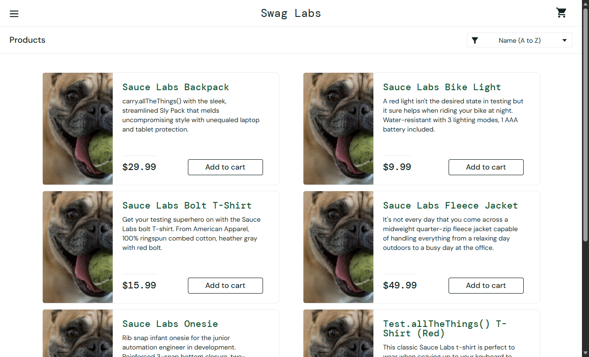
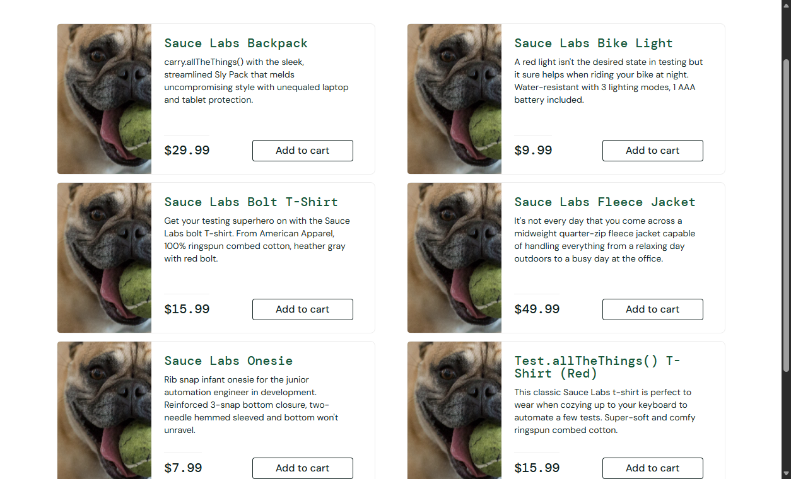
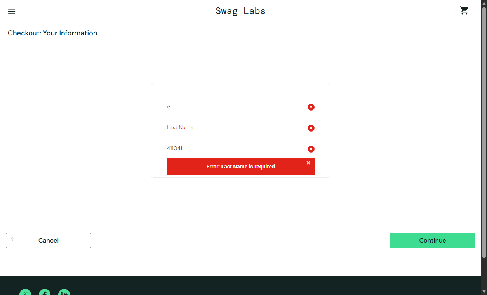
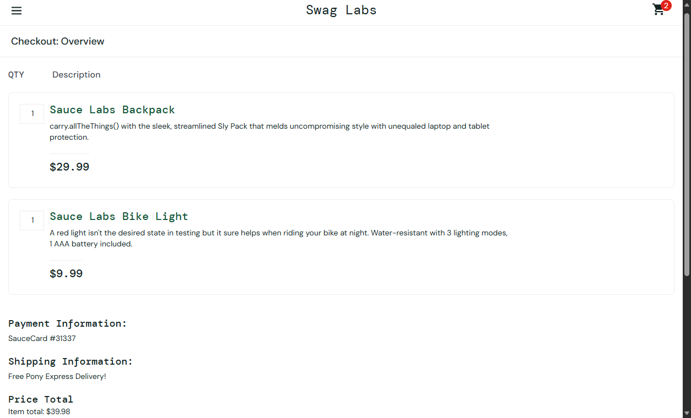
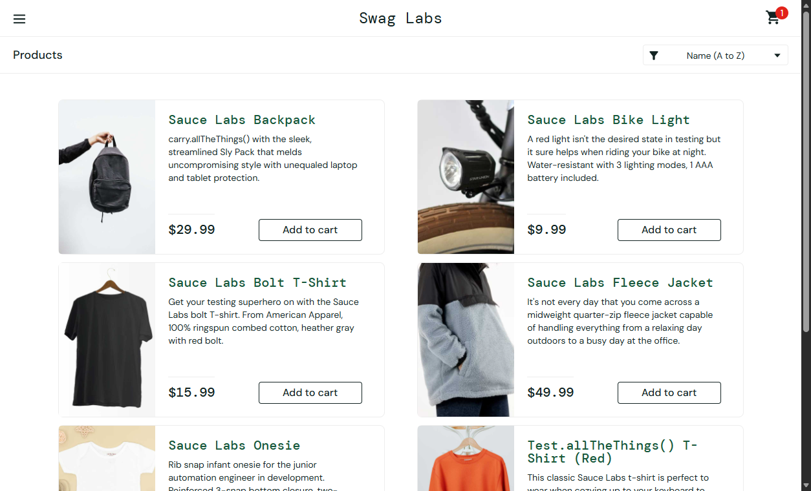
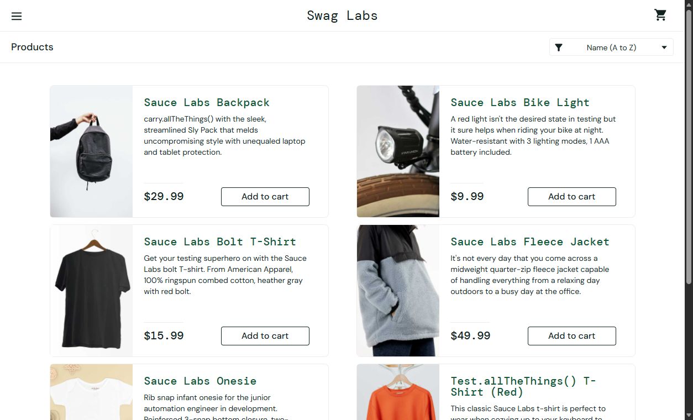
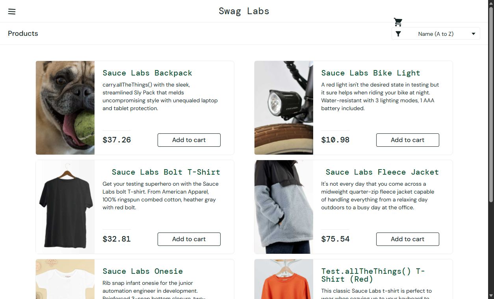

# Defect Reports - Swag Labs manual testing

9 defects were logged. Severity: how badly the defect affects the user. Priority: how soon it should be fixed.

## DEF-01: Wrong product images for problem_user

- **Module:** Products
- **Severity:** High
- **Priority:** Medium
- **Status:** Open
- **Environment:** Microsoft Edge 142, Windows 11, https://www.saucedemo.com
- **Linked test case:** TC_PROD_04

**Steps to reproduce**

1. Login as problem_user
2. Observe the Products page

**Expected result:** Each product shows its own image

**Actual result:** All six products show the same dog image

**Evidence:** `screenshots/15_problem_user_same_images.png`

## DEF-02: Price sorting does not reorder products for problem_user

- **Module:** Products
- **Severity:** Medium
- **Priority:** Medium
- **Status:** Open
- **Environment:** Microsoft Edge 142, Windows 11, https://www.saucedemo.com
- **Linked test case:** TC_PROD_05

**Steps to reproduce**

1. Login as problem_user
2. Select 'Price (low to high)'

**Expected result:** Products reordered 7.99 ... 49.99

**Actual result:** Order stays 29.99, 9.99, 15.99, 49.99, 7.99, 15.99

**Evidence:** `screenshots/16_problem_user_sort_broken.png`

## DEF-03: Add to cart has no effect for some products (problem_user)

- **Module:** Cart
- **Severity:** High
- **Priority:** High
- **Status:** Open
- **Environment:** Microsoft Edge 142, Windows 11, https://www.saucedemo.com
- **Linked test case:** TC_CART_04

**Steps to reproduce**

1. Login as problem_user
2. Click Add to cart on Fleece Jacket and T-Shirt (Red)

**Expected result:** Badge shows 2 and buttons change to Remove

**Actual result:** Nothing happens; no badge, buttons unchanged

**Evidence:** `screenshots/17_problem_user_add_to_cart_fails.png`

## DEF-04: Last Name field cannot be filled during checkout (problem_user)

- **Module:** Checkout
- **Severity:** Critical
- **Priority:** High
- **Status:** Open
- **Environment:** Microsoft Edge 142, Windows 11, https://www.saucedemo.com
- **Linked test case:** TC_CHK_10

**Steps to reproduce**

1. Login as problem_user, add an item, go to Checkout
2. Type in First Name, then Last Name, then Postal Code
3. Click Continue

**Expected result:** Overview page displayed

**Actual result:** Text typed into Last Name replaces First Name; Last Name stays empty; 'Error: Last Name is required'. Checkout is blocked.

**Evidence:** `screenshots/18_problem_user_lastname_bug.png`

## DEF-05: Checkout form accepts invalid data (all users)

- **Module:** Checkout
- **Severity:** Medium
- **Priority:** Medium
- **Status:** Open
- **Environment:** Microsoft Edge 142, Windows 11, https://www.saucedemo.com
- **Linked test case:** TC_CHK_05, TC_CHK_06

**Steps to reproduce**

1. Login as standard_user, add an item, go to Checkout
2. Enter First Name 12345, Last Name !!!, Postal Code abc
3. Click Continue

**Expected result:** Validation errors for name and postal code

**Actual result:** Form accepted; Overview page displayed

**Evidence:** `screenshots/10_checkout_invalid_data_accepted.png`

## DEF-06: Cart contents persist after logout and re-login

- **Module:** Cart
- **Severity:** Medium
- **Priority:** Low
- **Status:** Open
- **Environment:** Microsoft Edge 142, Windows 11, https://www.saucedemo.com
- **Linked test case:** TC_CART_05

**Steps to reproduce**

1. Login as standard_user, add Onesie
2. Logout
3. Login again as standard_user

**Expected result:** Cart is empty after fresh login

**Actual result:** Badge shows 1; Onesie still in cart

**Evidence:** `screenshots/14_cart_persists_after_relogin.png`

## DEF-07: Sorting shows a JavaScript alert for error_user

- **Module:** Products
- **Severity:** Medium
- **Priority:** Medium
- **Status:** Open
- **Environment:** Microsoft Edge 142, Windows 11, https://www.saucedemo.com
- **Linked test case:** TC_PROD_06

**Steps to reproduce**

1. Login as error_user
2. Select 'Name (Z to A)'

**Expected result:** Products reordered

**Actual result:** Alert 'Sorting is broken! This error has been reported to Backtrace.'

**Evidence:** `screenshots/19_error_user_sort_alert.png`

## DEF-08: Login takes about 7 seconds for performance_glitch_user

- **Module:** Login
- **Severity:** Medium
- **Priority:** Low
- **Status:** Open
- **Environment:** Microsoft Edge 142, Windows 11, https://www.saucedemo.com
- **Linked test case:** TC_LOGIN_08

**Steps to reproduce**

1. Login as performance_glitch_user and measure time to Products page

**Expected result:** Page loads within 3 seconds

**Actual result:** About 6.8 seconds

**Evidence:** `screenshots/20_performance_glitch_user.png`

## DEF-09: Wrong prices and misaligned layout for visual_user

- **Module:** Products
- **Severity:** High
- **Priority:** Medium
- **Status:** Open
- **Environment:** Microsoft Edge 142, Windows 11, https://www.saucedemo.com
- **Linked test case:** TC_PROD_07, TC_PROD_08

**Steps to reproduce**

1. Login as visual_user
2. Compare prices and layout with standard_user

**Expected result:** Backpack $29.99, Bike Light $9.99; cart icon aligned in header

**Actual result:** Backpack $69.96, Bike Light $91.76, Bolt T-Shirt $14.41, Fleece Jacket $47.3; cart icon drops below header; titles shifted

**Evidence:** `screenshots/21_visual_user_layout.png`

